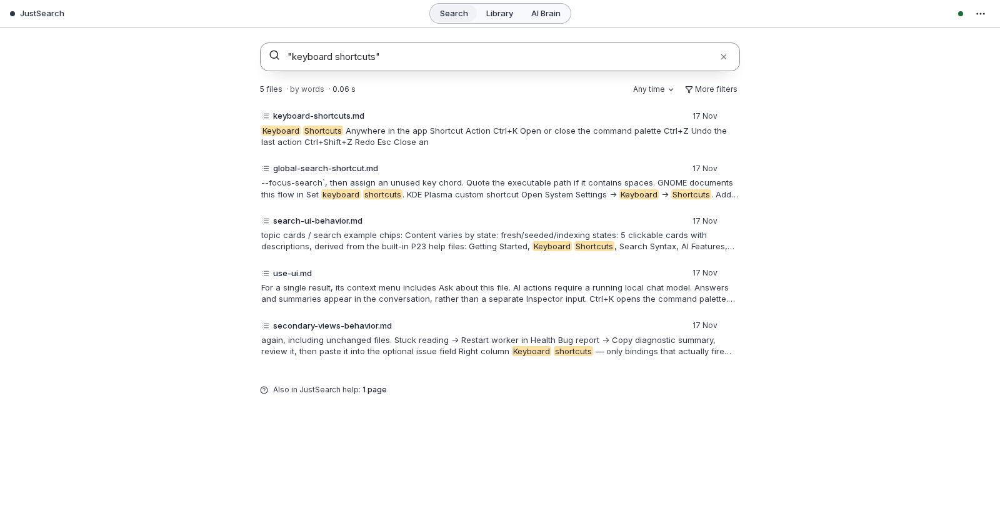
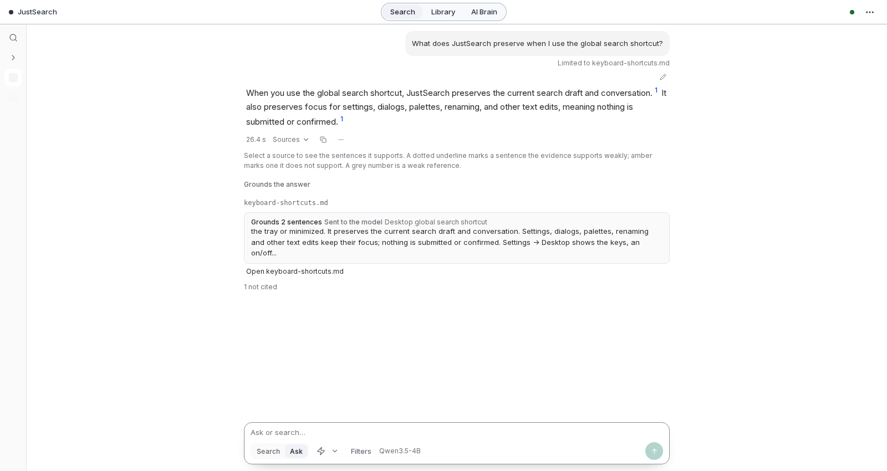

# JustSearch

**JustSearch finds what is inside your files, quickly and accurately, whether you know exactly what you are looking for or only vaguely. It is for anyone who keeps files on their computer, as a search app of its own or as a tool inside other apps and AI agents through MCP.**

It is local-first: your files are read, indexed and searched on your own computer, and the built-in
assistant answers on it too.

[](LICENSE)
[](https://github.com/justsearch-app/justsearch/actions/workflows/ci.yml)
[](https://github.com/justsearch-app/justsearch/releases/latest)
<!-- mcp-name: io.github.justsearch-app/justsearch -->
<!-- ^ Official MCP Registry ownership marker (modelcontextprotocol.io/registry/package-types);
     must match "name" in packaging/mcpb/server.json. Do not remove. -->

<p align="center">
  
</p>
<p align="center">
  
</p>

## What it does

- **Search by words or by meaning.** Type the exact phrase, or describe what you remember. Results
  from both ways of searching are combined, and a second model can put the best matches first.
- **Answers with sources.** Ask a question and get an answer that cites the passages it came from,
  written by a model running on your computer.
- **Reads what you have.** PDF, Office, email and most common document formats, and the text in
  scanned pages and images.
- **Works in many languages.** One setup for all of them; measured on English, German and French.
- **Works offline.** After the optional AI download, searching and answering need no connection.
  There is no account and no usage analytics.
- **A tool for AI agents.** Claude, Codex, Cursor and other MCP clients can search your files
  through JustSearch.

How it compares with other tools: [sourced comparison](docs/comparison.md).

## Install

Download the package for your system from the
[latest release](https://github.com/justsearch-app/justsearch/releases/latest).

| | Windows | Linux |
|---|---|---|
| **Package** | `JustSearch_<version>_x64-setup.exe` | `JustSearch_<version>_amd64.deb` |
| **System** | Windows 10 or 11, 64-bit (tested on Windows 11) | Ubuntu 24.04 or newer, x86_64 |
| **Install** | Run the installer. It is per-user; no admin rights needed. | `sudo apt install ./JustSearch_<version>_amd64.deb` |
| **Answers** | With an NVIDIA graphics card that has at least 8 GB of memory | Not yet: the Linux package searches, it does not answer |

Then start JustSearch and add a folder. Searching by words works as soon as the first files are
read. **AI Brain → Install AI** adds searching by meaning and, where supported, answers. It shows
what it will download before it starts: 2–4 GB without a supported NVIDIA graphics card, about
10 GB with one. Plan for 16 GB of RAM and 15 GB of free disk space for the full setup.

The Windows installer is code-signed; the publisher shown is **Elias Justus**. Windows SmartScreen
can still show a prompt while the certificate is new. To check a download yourself, see
[Verify your download](docs/how-to/verify-your-download.md). macOS is not supported
([NON-GOALS](NON-GOALS.md)). To build from source, see [`CONTRIBUTING.md`](CONTRIBUTING.md).

**Official downloads.** JustSearch is free. The app and its MCP bundle are published only on this
repository's [Releases page](https://github.com/justsearch-app/justsearch/releases); the Windows installer there is
code-signed by Elias Justus.
A copy sold for money, or offered by another store or site, does not come from this project; please
report it in an [issue](https://github.com/justsearch-app/justsearch/issues).

## Use it from an AI agent

JustSearch has a built-in MCP server, so an AI agent can search your files, get passages with
their sources, browse folders and ask to add files (you approve that in the app). The app must be
running. Each release includes a small bridge, `justsearch-mcp.mcpb`, that finds the running app
and signs in to it by itself:

- **Claude Desktop:** open the `.mcpb` file (Settings → Extensions).
- **Claude Code, Codex CLI, Cursor and other clients that start a local server:** the `.mcpb` file
  is a zip archive. Unpack it and register its bridge, which needs Node.js:

  ```bash
  claude mcp add justsearch -- node /path/to/justsearch-mcp/server/index.js
  ```

The passages an agent retrieves go to the client you connected. A cloud-hosted client forwards them
to its model provider like any other tool result. Details:
[MCP server reference](docs/reference/mcp-production-server.md).

## Benchmarks

How well the search finds the right passage, as nDCG@10 (1.0 is a perfect ranking), in release
`linux-complete-qrels-2026-11-02`:

| Collection | nDCG@10 | What it is |
|---|---|---|
| BEIR / SciFact | **0.759** | Scientific claims, a standard public benchmark |
| Enron-QA | 0.806 | Questions about business email |
| MIRACL-de (German) | 0.986 | Wikipedia questions, small document pool |
| MIRACL-fr (French) | 0.990 | Wikipedia questions, small document pool |
| Legal (CLERC case-retrieval) | WITHHELD | The re-ranking model was too slow on these long queries |

How to read this: the numbers were measured on Linux with an NVIDIA RTX 4070, with words, meaning
and re-ranking combined. On a computer without a supported graphics card, re-ranking is off unless
you switch on **Best match first** in AI Brain. The two MIRACL scores come from
document pools much smaller than the published benchmark's, so they are not comparable with
published results. The fair summary is that an offline system lands in the range of strong published
retrievers, not that it beats them. Everything behind the table, including how to reproduce it, is
in the [methodology](docs/reference/benchmarks/methodology.md); CI checks the scores above against
the release file. What the research project studies is in [`RESEARCH.md`](RESEARCH.md).

### Agent-utility publication status

**Agent-utility campaign freeze (2026-11-09):** Fresh and resumed live agent-utility campaigns are frozen. Their commands and runbooks remain available for historical reproduction and offline analysis, along with published evidence and offline replay. Neighboring experiments retain their existing status.

Separate from retrieval quality above, we also measure *agent utility* (does an agent with JustSearch tools
answer better than one without?) under a fail-closed publication policy:

<!-- agent-utility:generated:start - run: node scripts/docs/gen-public-agent-utility.mjs -->

Accepted publication `agent-utility-hero-2026-07-28` (record `c5a75457b264`, policy `agent-utility-public-v4`). Agents adopted JustSearch, but the campaign did not establish an efficiency or accuracy improvement across every required stratum.

Accuracy intervals are recomputed from the published observations under v5 question-level semantics (95% question-cluster bootstrap; seeds are replicates within questions). Point estimates and the historical adoption-only outcome are unchanged. Token and cost intervals remain descriptive cell-level intervals. Provenance: `scripts/jseval/public-agent-utility/question-level.v1.json`; reproduce with `python -m jseval.utility_public_projection --check`. The hash-pinned v4 bundle is unchanged.

[See the per-stratum evidence, provenance, and limitations](docs/reference/benchmarks/agent-utility.md).

<!-- agent-utility:generated:end -->

## Privacy

Reading, indexing, searching and the built-in assistant run on your computer. JustSearch uses the
network only for these:

- **Install AI** downloads models and the programs that run them from `github.com` and
  `huggingface.co`, after you agree.
- **Update checks** run shortly after the app starts. They send no file content and no searches,
  and can be switched off.
- **An AI agent you connect** receives the passages and file paths it asks for.
- **Trace export** is off by default and sends data only to an address you configure.

**Report a problem** only opens the bug report page in your browser. Every network path, the
switches and what each request reveals are in the
[threat model](docs/reference/security/threat-model.md) and the
[policy reference](docs/explanation/15-enterprise-policy.md).

## How it is built

- **Desktop shell:** Tauri (Rust), with a Lit web-components frontend. It starts and supervises the
  Engine.
- **Engine:** one Java process that serves the local API and the MCP server and owns the Lucene
  index and the search pipeline. Text extraction (Apache Tika, plus OCR) runs in separate child
  processes.
- **Models:** an embedding model
  ([gte-multilingual-base](https://huggingface.co/Alibaba-NLP/gte-multilingual-base)) and a
  re-ranking model run inside the Engine; answers come from a separate local `llama-server`
  (llama.cpp).

More in the [system overview](docs/explanation/01-system-overview.md) and the
[API contract map](docs/reference/api-contract-map.md).

JustSearch is developed with AI coding agents (Claude Code and OpenAI Codex) working under a
written agreement, [`AGENTS.md`](AGENTS.md): the agent that builds a change is never the
only judge of it, and a failure that was reported on the running app is checked on the running app.
The checks, the release steps and the design history are in this repository
([`MAINTAINING.md`](MAINTAINING.md), [cutting a release](docs/how-to/cut-a-release.md),
`docs/tempdocs/`). Three decisions shape the project:

- **Your computer does the work.** Cloud processing would add running costs and privacy obligations
  this project cannot carry ([NON-GOALS](NON-GOALS.md)).
- **Numbers are published under rules set beforehand.** A result that does not meet them is
  withheld or reported as it is, such as the legal row and the agent-utility result above.
- **A release is the exact files that were tested.** Packages are built once, signed, tried on
  clean machines and then published without rebuilding.

## Status

**Alpha.** Windows and Linux; public since June 2026. What changed in each version is in the
[changelog](CHANGELOG.md).

## Contributing

Contributions welcome: see [`CONTRIBUTING.md`](CONTRIBUTING.md) (CLA required) and read
[`NON-GOALS.md`](NON-GOALS.md) first so a change fits the project's scope. You do not need any of
the agent machinery to contribute. Security: [`SECURITY.md`](SECURITY.md).

## License

[Apache-2.0](LICENSE). Bundled model and dependency licenses: [`NOTICE`](NOTICE) / [`THIRD_PARTY_NOTICES`](THIRD_PARTY_NOTICES).
