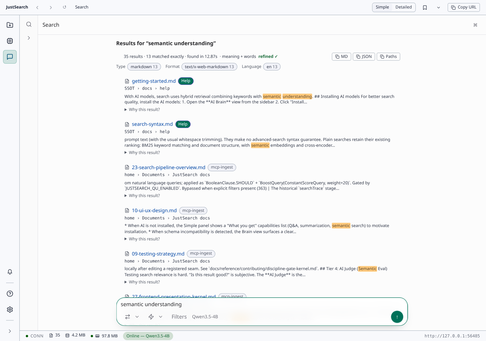

# JustSearch

**A private retrieval backend for your AI agents — and a neural search engine with a cited, on-device AI assistant for your own files. Hybrid search (BM25 + dense vectors + learned-sparse + reranking) plus grounded Q&A, summarization, and extraction over your documents — with indexing, search, and built-in AI on your machine. Windows installer; on Linux, runs from source.**


[](LICENSE)
[](https://github.com/justsearch-app/justsearch/actions/workflows/ci.yml)
[](https://github.com/justsearch-app/justsearch/releases)
<!-- badges: <<nDCG benchmark badge>> — deferred: no workflow publishes a benchmark badge yet -->
<!-- mcp-name: io.github.justsearch-app/justsearch -->
<!-- ^ Official MCP Registry ownership marker (modelcontextprotocol.io/registry/package-types);
     must match "name" in packaging/mcpb/server.json. Do not remove. -->

<!-- HERO VISUAL PLACEHOLDER (m1-shippability):
     Add a hero screenshot + short demo GIF here. Exact shots to take and how:
     docs/m1-screenshot-instructions.md
     Suggested markup once assets exist in docs/assets/:
     <p align="center"></p>
-->

JustSearch is local-first: it indexes your local documents — PDF, email, Office, and most common document
formats (text extraction is backed by [Apache Tika](https://tika.apache.org/), plus OCR for scanned PDFs and
images) — and answers questions over them with cited passages, **with indexing, retrieval, and built-in AI inference on your machine.**
It combines three retrieval paradigms (keyword, dense-vector, learned-sparse) with a cross-encoder reranker,
and exposes that retrieval over the **Model Context Protocol (MCP)** so any AI agent — local or cloud — can
use it as a **private retrieval backend**: indexing and retrieval stay on your device. The built-in
assistant keeps the whole loop on-device. When you connect an external AI client, the retrieved passages
and their metadata are handed to that client, and what happens to them from there is governed by that
client and its model provider, not by JustSearch.

It is multilingual by construction: the embedding model
([gte-multilingual-base](https://huggingface.co/Alibaba-NLP/gte-multilingual-base)) supports 70+ languages;
retrieval quality is benchmarked on English, German, and French (see [Benchmarks](#benchmarks)).

## Install (Windows)

1. **Download** [`JustSearch_0.3.0_x64-setup.exe`](https://github.com/justsearch-app/justsearch/releases/download/v0.3.0/JustSearch_0.3.0_x64-setup.exe)
   (261 MB) from the [v0.3.0 release](https://github.com/justsearch-app/justsearch/releases/tag/v0.3.0).
2. **Run it.** The installer is **code-signed** — the publisher shown is **Elias Justus**. Windows
   SmartScreen may still show a reputation prompt while the signing certificate is new (reputation
   accrues with downloads); if it does, the "More info" panel names the verified publisher. The
   install is per-user; no admin rights needed.
3. **Launch JustSearch** and point it at a folder. Use **AI Brain → Install AI** to download the optional
   models and runtimes from `github.com` and `huggingface.co`. The dialog shows the exact download size
   for your hardware: about **10 GB** on Windows with a supported NVIDIA GPU, or **2–4 GB** without one.
   Search and built-in AI inference then work offline; the desktop app also checks for updates by default
   when the build embeds a release URL (including CI-built branch candidates and pre-releases; see [Privacy](#privacy)).

Installer SHA-256 (also in [`SHA256SUMS`](https://github.com/justsearch-app/justsearch/releases/download/v0.3.0/SHA256SUMS)):

```text
465b9a90f763471bf5b6e33261d5eb17d3cf58981acb5d58d8d67dfd4da2d33f  JustSearch_0.3.0_x64-setup.exe
```

<!-- hash verified 2026-09-07 against the asset downloaded from the published v0.3.0 GitHub
     release (Authenticode Valid, CN=Elias Justus, SSL.com timestamped; 261,223,328 bytes measured). -->

Full walkthrough (hash and publisher verification, Windows reputation guidance,
build-from-source alternative): [`docs/how-to/verify-your-download.md`](docs/how-to/verify-your-download.md).

## System requirements

| | |
|---|---|
| **OS** | **Windows 10 or 11, 64-bit (x64) only** for the installer. On Linux, JustSearch runs from source ([Quickstart](#quickstart-build-from-source)); there is no Linux installer. macOS is not in the current scope ([NON-GOALS](NON-GOALS.md)). Verified on Windows 11; Windows 10 x64 is the expected WebView2 baseline but is not yet explicitly tested. WebView2, the VC++ runtime, and a Java runtime are bundled by the installer; there is nothing to install first. |
| **Disk** | 261 MB installer + ~0.7 GB installed + **about 10 GB for AI with a supported NVIDIA GPU (2–4 GB without one)** + the search index (grows with your corpus). Plan for **≥ 15 GB free**. |
| **RAM** | **16 GB recommended.** 8 GB is a conservative floor for keyword/semantic search only (not a benchmarked minimum; chat needs the GPU below regardless of RAM). The on-device chat model (~5.9 GB file) is loaded into memory when answering. |
| **GPU** | **Required for chat.** Search and semantic ranking run on CPU — no GPU needed for those. Chat requires an NVIDIA GPU with **≥ 8 GB VRAM** (the app needs ~7.5 GB free VRAM to run the chat model). Without a supported NVIDIA GPU, or below that VRAM floor, no install path offers the chat model — chat does **not** fall back to CPU, so the app is search-only. |
| **Network** | AI downloads and default launch-time update checks in desktop builds with an embedded release URL; optional trace export when configured. See [Privacy](#privacy) for all network paths and update controls. |

## Two ways to use it

**As a private MCP retrieval backend for agents** *(the fast path for developers)*
JustSearch exposes its retrieval over MCP at `POST /mcp` — **in-process Streamable HTTP** on the loopback API
(no separate process, no Node.js). The desktop app listens on **`http://127.0.0.1:8080`** by default; if 8080
is already taken it falls back to a random free port. To pin a port, set the `JUSTSEARCH_API_PORT` environment
variable before launching; the actual port in use is always written as `head.apiPort` in
`%APPDATA%\io.justsearch.shell\runtime\manifest.json` on Windows, or
`~/.local/share/io.justsearch.shell/runtime/manifest.json` on Linux (under
`$XDG_DATA_HOME/io.justsearch.shell/runtime/manifest.json` if `XDG_DATA_HOME` is set).
For headless/dev launches with a data directory override, use
`<JUSTSEARCH_DATA_DIR>/runtime/manifest.json`. Details + a 2-minute Claude Desktop walkthrough:
[`docs/reference/mcp-production-server.md`](docs/reference/mcp-production-server.md). Connect your agent:

- **Claude Code:** `claude mcp add justsearch --transport http http://127.0.0.1:8080/mcp`
- **Codex CLI:** `codex mcp add justsearch --url http://127.0.0.1:8080/mcp`
- **Cursor / VS Code** (clients that accept an HTTP `url` directly — e.g. `.cursor/mcp.json`):
  ```json
  { "mcpServers": { "justsearch": { "url": "http://127.0.0.1:8080/mcp" } } }
  ```
- **Claude Desktop** — add it as a **Connector** (Settings → Connectors → Add custom connector → the URL above),
  or bridge stdio→HTTP with `mcp-remote` in `claude_desktop_config.json`:
  ```json
  { "mcpServers": { "justsearch": { "command": "npx", "args": ["mcp-remote", "http://127.0.0.1:8080/mcp"] } } }
  ```

If an older build returns 404 for `POST /mcp`, use the current release or a from-source build.

Seven tools: `justsearch_answer` (RAG, primary), `justsearch_search`, `justsearch_browse`, `justsearch_ingest`,
`justsearch_status`, `justsearch_runtime_manifest`, `justsearch_operation_outcome`. The server binds to
loopback and itself sends nothing anywhere beyond returning results to the connected client. The passages
it returns go to whichever client you connected — a cloud-hosted agent will forward them to its model
provider like any other tool result. Optional Engine trace export is described in [Privacy](#privacy).

Does wiring an agent to these tools measurably improve its answers? We benchmark that under a fail-closed
publication policy. The one accepted publication so far is *adoption-only*: agents used the tools, but no
stratum showed an accuracy or efficiency improvement — see the
[status note](#agent-utility-publication-status) below and
[`docs/reference/benchmarks/agent-utility.md`](docs/reference/benchmarks/agent-utility.md).

**As a desktop app** *(for non-developers)*
Follow [Install (Windows)](#install-windows) above, point it at a folder, and search.
*(Windows; alpha; code-signed as of v0.2.0 — see [Status](#status).)*

## Why JustSearch

Desktop file search is either **fast-but-lexical** (Everything — filenames, instantly; Recoll — full-text and
even OCR, but keyword matching only) or **smart-but-cloud** (NotebookLM, Copilot — capable, but your files
leave your machine). Self-hosted server stacks (RAGFlow, Open WebUI, QAnything) can combine semantic retrieval,
offline operation, multilingual models, and OCR — if you deploy and configure a Docker stack yourself.
JustSearch aims at the gap between those worlds: as far as we know, the only **single-install desktop app**
that ships **{true hybrid retrieval × offline search and AI × multilingual × OCR}** out of the box — here is the
[sourced comparison](docs/comparison.md) behind that sentence, and if we've missed a tool, please
[open an issue](https://github.com/justsearch-app/justsearch/issues) and we'll list it.

- **Hybrid retrieval, not single-model RAG** — BM25 + dense vectors + SPLADE learned-sparse, fused and reranked
  by a cross-encoder. Most local RAG tools use one embedding model and basic chunking.
- **Local search and AI** — indexing, retrieval, and built-in inference run on-device and work offline
  after AI setup. The desktop app also checks for updates by default; [Privacy](#privacy) names the network paths
  and the optional trace exporter.
- **Multilingual by construction** — one locale-invariant pipeline (ICU + a multilingual model stack), no
  per-language tuning. Competitive nDCG on German and French, not just English.
- **Vision OCR** — extracts text from scanned PDFs and images, so they're searchable too.
- **BYO-LLM** — runs your own local model via llama.cpp; no API keys, no per-token cost.

## Benchmarks

Retrieval quality (nDCG@10) from one reproducible release run (`scripts/jseval/release.v1.json`, RTX 4070,
~300 queries/corpus; measured on the canonical 2026-08-14 release tree — the first release scored on the
corrected delivered-ranking basis, tempdoc 803). Numbers are
the **default `hybrid` config** unless noted:

| Corpus | nDCG@10 | Note |
|---|---|---|
| BEIR / SciFact | **0.757** | in the range of published single-model retrievers (ColBERTv2 0.693, SPLADE++ 0.71) — but read this as *system vs. component*: ours is a full hybrid+rerank pipeline, theirs are single models |
| Enron-QA | 0.796 | |
| MIRACL-de (German) | 0.857 | multilingual — no per-language tuning |
| MIRACL-fr (French) | 0.884 | |
| Legal (CLERC case-retrieval) | 0.578 | citation-retrieval task on real US federal case law; replaces an earlier bespoke legal corpus that had no reproducible construction path (tempdoc 666) |

External-baseline figures are cited from published papers (SIGIR/NAACL; sources + split caveats in
`release.v1.json`) — **not** re-run by us, and not directly apples-to-apples: a hybrid+rerank *system* is
expected to exceed single-model *components*, and MIRACL baselines are a different (dev) split. The honest
reading is "a reproducible offline hybrid system lands in the range of strong published retrievers," not
"we beat them" — full comparison-class notes in
[the methodology](docs/reference/benchmarks/methodology.md#how-to-read-the-comparison-system-vs-component).
Per-corpus nDCG@10 floors are checked against a pinned baseline at release-composition time
(`python -m jseval relevance-gate`, `scripts/jseval/relevance-ratchet-baselines.v1.json`); that is a
local gate run when a release is composed, not an automated CI job. The README table itself is checked
against the release object in CI (`scripts/ci/check-readme-benchmark-numbers.mjs`).

Reproduce (from `scripts/jseval`): `python -m jseval run --start-backend --dataset beir/scifact --modes hybrid`
then `python -m jseval relevance-gate --dataset beir/scifact`. Slugs: `beir/scifact`, `mixed/enron-qa`,
`mixed/legal-clerc-200`, `mixed/miracl-de-2k`, `mixed/miracl-fr-2k`.
Full methodology, comparison-class caveats, and reproduction:
[`docs/reference/benchmarks/methodology.md`](docs/reference/benchmarks/methodology.md). The table above is
hand-written from `scripts/jseval/release.v1.json` (the canonical 2026-08-14 release); CI checks every
number it shows against that file (`scripts/ci/check-readme-benchmark-numbers.mjs`).
For the broader research angle — open questions, what's deferred, and how to get involved — see
[`RESEARCH.md`](RESEARCH.md).

### Agent-utility publication status

Separate from retrieval quality above, we also measure *agent utility* (does an agent with JustSearch tools
answer better than one without?) under a fail-closed publication policy:

<!-- agent-utility:generated:start - run: node scripts/docs/gen-public-agent-utility.mjs -->

Accepted publication `agent-utility-hero-2026-07-28` (record `c5a75457b264`, policy `agent-utility-public-v4`). Agents adopted JustSearch, but the campaign did not establish an efficiency or accuracy improvement across every required stratum.

[See the per-stratum evidence, provenance, and limitations](docs/reference/benchmarks/agent-utility.md).

<!-- agent-utility:generated:end -->

## Quickstart (build from source)

> Prereqs to **build + test**: **JDK 25** (the Gradle toolchain auto-resolves it) and **Node.js 24** (for the
> `modules/ui-web` frontend). Building/contributing needs **no GPU, no Rust toolchain, and no model
> download**; AI models are runtime-only (Install AI downloads them with your consent).

```bash
git clone https://github.com/justsearch-app/justsearch && cd justsearch
./gradlew build                  # Linux, or Windows Git Bash
```

On Linux, install JDK 25, Node 24, a C compiler (`cc`) and Tesseract. GPU development also
needs an NVIDIA driver, a CUDA-enabled llama-server built from the project's pinned llama.cpp
version (`b8571`), and the ORT CUDA 12 libraries. Export the regular executable as
`JUSTSEARCH_SERVER_EXE`; make it executable and put its required shared libraries on the loader's
search path. Keep ORT's CUDA 12 dependencies available even if llama-server uses another CUDA
version.

To **run** the full desktop app, the easy path is the [installer](#install-windows) above; running the
Engine stack from source is a developer workflow — see [`CONTRIBUTING.md`](CONTRIBUTING.md). The installed
app offers **Install AI** with your consent (about **10 GB** on Windows or **8 GB** on Linux with a
supported NVIDIA GPU; **2–4 GB** without one). On Windows this includes a CUDA build of `llama-server`
that is selected automatically on supported NVIDIA hardware, unless you set your own executable.
Building from source does not download models: keyword search works without them, and
`node scripts/dev/doctor.mjs` names the step to the next tier. See [Privacy](#privacy) for downloads,
update checks, and optional trace export.

## Architecture

The Engine JVM hosts the loopback-only API gateway and the index half, composed through ports.

- **Desktop shell** — Tauri hosts the Lit/web-components frontend and supervises the Engine.
- **Engine** — API gateway, Lucene ownership in the index half, retrieval pipeline and extraction orchestration.
- **Inference** — a separate local `llama-server` for chat/RAG.

The Engine halves share an address space; application code reaches the index through ports. More: [`docs/explanation/01-system-overview.md`](docs/explanation/01-system-overview.md).
The public API surface is mapped in [`docs/reference/api-contract-map.md`](docs/reference/api-contract-map.md).

## Privacy

Indexing, retrieval, and built-in AI inference run locally. Network activity has these paths:

- **Install AI** downloads models and runtimes from `github.com` and `huggingface.co` (and their download
  redirects), with your consent. Repair and upgrades can download them again. On Windows, supported NVIDIA
  hardware also gets a CUDA build of `llama-server`, selected automatically unless you chose your own executable.
- **The desktop app checks for updates by default**, about 30 seconds after the desktop chrome mounts when a release URL is
  embedded. CI-built installers embed the repository's configured URL, including branch candidates and pre-releases.
  Discovery fetches `release.v1.json`, `release.v1.json.sig` and `latest.json` from GitHub, following download/CDN redirects;
  installation rechecks `latest.json` and downloads installer bytes only on request. Contacted hosts see
  your IP address and request time; these requests send no document content or queries.
  Set `JUSTSEARCH_AUTO_UPDATE_CHECK=false` before starting a fresh desktop process to suppress automatic
  checks; Settings and recovery manual checks still work when policy allows them. Set `{"schemaVersion": 1, "appUpdatesEnabled": false}` in
  `policy.v1.json` to forbid all new updater checks and downloads, including with the Engine down.
  Windows machine policy is `%PROGRAMDATA%\JustSearch\policy.v1.json`; user policy is in the shell's
  app-data directory (passed to the Engine as `JUSTSEARCH_HOME`). User policy can only further restrict
  machine policy. Rust reads policy at each discovery and install, and again before artifact download.
  A discovery already in flight may finish its metadata requests; disabling updates preserves local
  upgrade and rollback state. The optional key keeps schemaVersion 1; older releases ignore it, and the
  first enforcing release will be named in its release notes. These switches cover app updates only.
  Builds without a configured release URL do not check; debug builds can use an explicitly configured URL.
- **Trace export is off by default.** Enabling API or index tracing writes local traces. If you also set
  an `OTEL_EXPORTER_OTLP_*ENDPOINT`, traces go to that endpoint, which may be off-device. Traces can include
  file paths and bounded document excerpts. An endpoint alone does not enable tracing. See the
  [environment reference](docs/reference/configuration/environment-variables.md#trace-output-and-optional-otlp-export).
- **The desktop CSP** restricts frontend `fetch`/XHR/WebSocket to loopback and Tauri IPC; it does not
  govern the Rust updater or Engine downloads and trace export.
- **External integrations receive what you give them.** The loopback MCP server returns passages and file
  paths to the client you connect; a cloud-hosted client can forward them to its model provider. An optional
  MCP host configuration also launches user-chosen tools, whose data handling and network access you control.
  Links you open can launch an external browser.

There is no built-in usage analytics service. For the trust boundaries and verification anchors, see the
[threat model](docs/reference/security/threat-model.md).

## Status

**Alpha** (`0.3.0`), **Windows installer only** (Linux runs from source; macOS is not in the current scope). The installer is
**code-signed** (publisher: Elias Justus) as of v0.2.0; SmartScreen reputation for the new certificate
accrues with downloads, so an early reputation prompt is possible and names the verified publisher. In active
development since 2025; published 2026. Built in the open with heavy AI-agent assistance — the development
tooling, the governance/discipline gates, and the design history (`docs/tempdocs/`) all live in this repo, and
commits are co-authored.

## Contributing

Contributions welcome — see [`CONTRIBUTING.md`](CONTRIBUTING.md) (CLA required). Please read
[`NON-GOALS.md`](NON-GOALS.md) first so a change fits the project's scope. Security: [`SECURITY.md`](SECURITY.md).
You **don't** need any of the agent/governance machinery to contribute — it's published as transparency
([`MAINTAINING.md`](MAINTAINING.md)), not a required path. Interested in the research side (open questions,
what's deferred, collaboration) rather than contributing code? See [`RESEARCH.md`](RESEARCH.md).

## License

[Apache-2.0](LICENSE). Bundled model and dependency licenses: [`NOTICE`](NOTICE) / [`THIRD_PARTY_NOTICES`](THIRD_PARTY_NOTICES).
